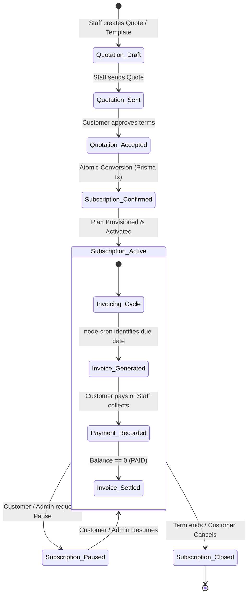

<div align="center">

# ⚡ BRIGHTLOOP
### Enterprise Subscription Management & Recurring Billing Platform
**Built for the Odoo x Make-A-Ton 9.0 Kochi Hackathon 2026**

[](https://nodejs.org/)
[](https://react.dev/)
[](https://www.typescriptlang.org/)
[](https://tailwindcss.com/)
[](https://www.prisma.io/)
[](https://sqlite.org/)
[](https://vitejs.dev/)

<p align="center">
  <b>A comprehensive, production-grade SaaS subscription engine powering customers, dynamic variants, quotations, recurring invoices, discounts, tax snapshots, manual payment ledgers, and a full customer self-service app store.</b>
</p>

[Quickstart Guide](#-1-minute-quickstart-for-evaluators) • [Live Demo Credentials](#-pre-seeded-demo-credentials) • [End-to-End Lifecycle](#-the-complete-subscription-lifecycle) • [Customer Portal & Marketplace](#-customer-self-service-portal--marketplace) • [Design System](#-design-system-refined-corporate-neo-brutalism) • [Automated Tests](#-automated-testing--verification-1313-passed)

</div>

---

## 🚀 Live Application

**Experience Brightloop:** 

🌐 Open Brightloop — Live Demo - https://subscription-management-system-taupe.vercel.app

Explore the complete subscription management platform, including the admin dashboard, subscription lifecycle, automated billing, invoice management, payment tracking, and customer self-service portal.

---

## 🌟 Executive Summary

**Brightloop** is a full-stack, enterprise-grade recurring billing and subscription management system designed to eliminate financial leakage, automate high-volume subscription renewals, and give enterprise customers complete self-service over their software subscriptions.

Unlike simple UI prototypes, **every single button, transition, modal, and filter in Brightloop connects directly to a persistent, atomic SQLite database through Prisma ORM with strict business rules, ACID transactions, and role-based access control (RBAC).**

```
┌────────────────────────────────────────────────────────────────────────────────────────┐
│                               BRIGHTLOOP ECOSYSTEM                                     │
├─────────────────────────────────────────┬──────────────────────────────────────────────┤
│       🏢 ADMIN & STAFF BACKOFFICE       │         🌐 CUSTOMER SELF-SERVICE PORTAL      │
│  • Customer Master Directory            │  • Live Financial & Subscription Overview   │
│  • Products & Dynamic Price Variants    │  • App Marketplace: Browse & Buy New Apps   │
│  • Subscription Frequency Plans         │  • Subscription Lifecycle: Pause / Resume    │
│  • Quotation Blueprints & Conversions   │  • Self-Service Cancellation with Guards    │
│  • Automated node-cron Billing Engine   │  • Invoice History & Due Date Alerts         │
│  • Discounts (Fixed & Basis Points)     │  • 1-Click Instant Payment Checkout (Sim)   │
│  • Multi-Tax Rules & Historical Snap    │  • Multi-Tenant Isolation & Zero Data Leak  │
│  • Manual Payment Collection & Ledger   │  • Company Profile & Billing Address Sync    │
│  • Real-Time C-Suite KPI Analytics      │  • Automated Receipt Tracking                │
└─────────────────────────────────────────┴──────────────────────────────────────────────┘
```

---

## 🔄 The Complete Subscription Lifecycle

Brightloop covers 100% of the customer contract journey with strict state machine validation:



1. **Catalog & Variant Definition:** Admins configure products (Software, Services) and define attribute variants with dynamic surcharges (`+₹560`, `+₹1,500`).
2. **Quotation Blueprinting:** Staff creates sales quotations with line items, quantities, and applicable discounts, or applies one-click pre-configured **Quotation Templates**.
3. **Atomic Conversion:** When accepted, an atomic database transaction converts the quotation into a verified `Subscription`, locking in contract prices and scheduling the next billing run.
4. **Automated Recurring Invoicing:** The `node-cron` background billing engine scans active subscriptions daily, calculates prorated amounts, applies discounts, captures tax rate snapshots, and generates sequential invoices.
5. **Idempotency Guarantee:** Backed by composite database unique constraints (`@@unique([subscriptionId, periodStart])`), recurring runs can never generate duplicate billing statements.
6. **Payment & Ledger:** Payments are recorded with precision in minor currency units (paise). Overpayments are strictly rejected, and invoice statuses advance automatically from `CONFIRMED` to `PAID`.
7. **Customer Self-Service:** Customers browse new products, buy additional plans, pause billing cycles, or cancel contracts directly from their authenticated portal.

---

## 🛍️ Customer Self-Service Portal & Marketplace

A standout capability in Brightloop is the dedicated **Subscriber Self-Service Portal**:

### 1. App Marketplace & Direct Checkout (`/portal/explore`)
* Customers don't need to wait for sales reps to purchase more software or services.
* **Live Catalog:** Search applications, filter by software suites vs. cloud services, and examine feature highlights.
* **Dynamic Edition Selector:** Switch between product editions/variants (Standard, Professional, Enterprise) with instant price recalibration.
* **Cadence Customizer:** Choose billing intervals (Monthly, Yearly, Weekly, Daily) with recurring cost breakdowns.
* **Instant Provisioning:** 1-click **"Confirm Subscription"** provisions the subscription, calculates billing schedules, and records an audit trail.

### 2. Contract Maintenance & Controls (`/portal/subscriptions`)
* **Pause Subscription:** Customers can pause billing temporarily (adhering to plan permissions).
* **Resume Subscription:** Reactivates the contract and updates the next billing cycle.
* **Cancel Subscription:** Explicit cancellation with safety confirmation dialogs to prevent accidental churn.
* **Entitlements Breakdown:** Detailed breakdown of subscribed product lines, quantities, and line totals.

### 3. Online Payments & Statements (`/portal/invoices`)
* Real-time invoices ledger with overdue badges.
* **1-Click "Pay Now" Modal:** Settle invoices instantly using the built-in simulated payment gateway.
* Automatic transition of invoice from `CONFIRMED` to `PAID` with instant balance clearance.

---

## 🎨 Design System: Refined Corporate Neo-Brutalism

Brightloop implements a **"Refined Minimalist Corporate Neo-Brutalism"** design system inspired by modern executive software:

* **Crisp 1px Structural Borders:** `#E5DFE4` defining all functional cards, tables, inputs, and dialogs.
* **Tactile 2px Flat Offset Shadows:** `shadow-card: 2px 2px 0px #E5DFE4` and `shadow-plum-btn: 2px 2px 0px #3E2134`.
* **Plum Corporate Identity:** Inspired by enterprise software aesthetics:

| Design Token | Hex Code | Purpose |
|---|---|---|
| **Primary Plum** | `#6A3D5B` | Primary buttons, active navigation pills, brand marks |
| **Deep Plum** | `#3E2134` | Tactile button drop shadows, dark banner cards |
| **Plum Surface** | `#F8F0F5` | Soft avatar backgrounds, selected rows, active icon containers |
| **Plum Border** | `#E8DCE5` | Subtle borders for plum-themed elements |
| **Canvas Background** | `#FAF7F5` | Warm, low-strain off-white corporate canvas |
| **Pure White** | `#FFFFFF` | Primary card surfaces, data tables, modals |
| **Primary Text** | `#1F1A1E` | High-contrast charcoal typography |
| **Secondary Text** | `#6B636A` | Table column titles, metadata, subtitles |
| **Mint Success** | `#047857` / `#D1FAE5` | Mint green `ACTIVE` status pills, completed payments |

* **Monospace Typography:** JetBrains Mono for monetary amounts, invoice numbers, dates, percentages, and subscription codes.

---

## 👥 Role-Based Access Control (RBAC) Matrix

Brightloop strictly segregates permissions across 3 user roles:

| Module / Action | 👑 Admin | 👔 Staff | 👤 Customer |
|---|:---:|:---:|:---:|
| **Executive Analytics & KPIs** | Full | Full | Own Account Only |
| **Customer Master Directory** | Full (CRUD) | Full (CRUD) | Own Profile Only |
| **Product & Variant Catalog** | Full (CRUD) | Read Only | Marketplace View |
| **Subscription Plans & Frequencies** | Full (CRUD) | Read Only | Marketplace View |
| **Quotation Templates & Blueprints** | Full (CRUD) | Full (CRUD) | None |
| **Quotation Creation & Conversion** | Full (CRUD) | Full (CRUD) | None |
| **Subscription Lifecycle (All)** | Full Control | Full Control | Own (Pause/Resume/Cancel) |
| **Run Background Billing Now** | ✅ Triggerable | ❌ Restricted | ❌ Restricted |
| **Discount Rules Engine** | Full (CRUD) | Read Only | ❌ Restricted |
| **Tax Configuration** | Full (CRUD) | Read Only | Read Only (Calculated) |
| **Payment Ledger & Recording** | Full Collection | Full Collection | Online Checkout (Own) |
| **Staff & User Provisioning** | ✅ Yes | ❌ Blocked (403) | ❌ Blocked (403) |
| **Customer Data Isolation** | Global | Global | Strictly Tenant-Locked |

---

## ⚡ 1-Minute Quickstart for Evaluators

Brightloop runs 100% locally with zero external paid APIs, cloud database accounts, or third-party gateways.

### 1. Prerequisites
- **Node.js**: `v18+` or `v20+` or `v22+` (tested on Node v22.19.0)
- **npm**: `v9+` or `v10+`

### 2. Clone & Automated Setup

```bash
# 1. Clone repository
git clone https://github.com/Mowsikan-Hariharasudhan/Subscription-Management-System.git
cd Bright-Loop

# 2. Run automated setup (Installs client & server deps, runs Prisma migrations, seeds demo DB)
npm run setup
```

### 3. Start Development Servers

```bash
# Concurrently launches Express Backend (port 5000) and Vite React Client (port 5173)
npm run dev
```

Open your browser at **[http://localhost:5173](http://localhost:5173)**.

---

## 🔑 Pre-Seeded Demo Credentials

The application is pre-seeded with realistic enterprise data (active subscriptions, multi-variant products, generated invoices, overdue alerts, and payments):

| Role | Email Address | Password | Intended Test Flow |
|---|---|---|---|
| **👑 Admin** | `admin@brightloop.io` | `Admin@1234` | Full backoffice, staff management, tax rules, discount rules, "Run Billing Now" |
| **👔 Staff** | `sarah@brightloop.io` | `Staff@1234` | Customer onboarding, quote creation, quote-to-subscription conversion, manual payment entry |
| **👔 Staff** | `mike@brightloop.io` | `Staff@1234` | Secondary staff operator account |
| **👤 Customer** | `customer1@example.com` | `Customer@1234` | Self-service subscriber portal: browse & buy apps, pause/resume subscriptions, pay invoices |
| **👤 Customer** | `customer2@example.com` | `Customer@1234` | Alternate customer account with outstanding balances and invoices |

> **Evaluator Tip:** The Login page features **1-Click Quick Demo Login buttons** for instant switching between Admin, Staff, and Customer without typing credentials!

---

## 🧪 Automated Testing & Verification (13/13 Passed)

Brightloop includes an automated end-to-end integration and business logic verification suite covering the core requirements:

```bash
npm test
```

### Test Results Summary:

```
======================================================
 STARTING BRIGHTLOOP ACCEPTANCE & INTEGRATION TEST SUITE
======================================================

 ✅ PASS: Scenario 1: Customer registration & login with password policy
 ✅ PASS: Scenario 2: Admin creates product with two variants
 ✅ PASS: Scenario 3: Admin creates monthly subscription plan
 ✅ PASS: Scenario 4: Staff creates quotation for customer
 ✅ PASS: Scenario 5: Quotation status flow: DRAFT -> SENT -> ACCEPTED -> Subscription
 ✅ PASS: Scenario 6 & 7: Billing engine identifies due subscription and generates invoice
 ✅ PASS: Scenario 8 & 9: Taxes snapshot & discount calculations on generated invoice
 ✅ PASS: Scenario 10 & 11: Recording payments, outstanding update, and transition to PAID
 ✅ PASS: Scenario 12: Finance dashboard server-side aggregation metrics
 ✅ PASS: Scenario 13: Closed subscription does not generate invoice
 ✅ PASS: Scenario 14: Billing idempotency — second execution creates 0 duplicates
 ✅ PASS: Scenario 15: Customer portal data isolation (cannot read other customer data)
 ✅ PASS: Scenario 16: Staff RBAC boundaries — forbidden from creating staff or discount rules

======================================================
 RESULTS: 13 PASSED, 0 FAILED (100% SUCCESS)
======================================================
```

---

## 🏗️ Technical Architecture & Monorepo Structure

```
Bright-Loop/
│
├── client/                              # Modern React 18 + TypeScript SPA
│   ├── src/
│   │   ├── components/
│   │   │   ├── layout/                  # White neo-brutal Sidebar, TopNav, AppShell
│   │   │   ├── shared/                  # DataTable, StatusBadge, CurrencyDisplay, PageHeader
│   │   │   └── ui/                      # Button, Dialog, Card, Input, Label, Badge, Tabs
│   │   ├── context/                     # AuthContext (JWT session, RBAC guards)
│   │   ├── pages/
│   │   │   ├── auth/                    # Split-pane Hero Login, Register, Password Reset
│   │   │   ├── dashboard/               # 5 KPI cards, Recharts Area/Donut, Tables
│   │   │   ├── customers/               # Customer Directory (Kanban / List view)
│   │   │   ├── products/                # Catalog & Variant Price Surcharges
│   │   │   ├── plans/                   # Subscription Billing Intervals & Pause Rules
│   │   │   ├── quotations/              # Quotation Builder & Blueprint Templates
│   │   │   ├── subscriptions/           # Full Lifecycle Management & Detail Views
│   │   │   ├── invoices/                # Invoices, Line Items, & Instant Billing Trigger
│   │   │   ├── payments/                # Payment Recording Modal & Historical Ledger
│   │   │   ├── discounts/               # Fixed & Basis Points Discount Rules Engine
│   │   │   ├── settings/                # Tax Rules, System Settings, Staff Provisioning
│   │   │   └── customer-portal/         # Subscriber Portal:
│   │   │       ├── CustomerDashboard    # Subscriber Welcome Hero & KPI Cards
│   │   │       ├── ExplorePlans         # Marketplace: Browse & Buy New Applications
│   │   │       ├── MySubscriptions      # Active Contracts, Entitlements, Pause/Resume
│   │   │       ├── MyInvoices           # Invoices, Overdue Badges, 1-Click Pay Now
│   │   │       ├── MyPayments           # Verified Transaction History
│   │   │       └── AccountSettings      # Company Profile & Billing Address Sync
│   │   ├── services/                    # Typed Axios HTTP API Services
│   │   └── types/                       # Shared TypeScript Interfaces
│   └── package.json
│
├── server/                              # Express + TypeScript + Prisma Backend
│   ├── prisma/
│   │   ├── schema.prisma                # 20 Normalized Models, Foreign Keys, Indexes
│   │   └── seed.ts                      # Enterprise Demo Data Seeder
│   ├── src/
│   │   ├── config/                      # Prisma Client, WAL Mode Pragmas, Env Loader
│   │   ├── controllers/                 # Express Route Handlers
│   │   ├── jobs/                        # node-cron Scheduled Billing Engine
│   │   ├── middleware/                  # JWT Auth, Role RBAC, Zod Validation, Errors
│   │   ├── routes/                      # Modular REST Endpoints (/api/v1/*)
│   │   ├── services/                    # Business Logic, Billing Engine, Invoicing
│   │   ├── tests/                       # 16-Scenario Automated Acceptance Suite
│   │   └── utils/                       # Paise Minor Units, Audit Logger, Pagination
│   └── package.json
│
├── package.json                         # Monorepo Scripts (setup, dev, test, build)
└── README.md                            # Comprehensive Hackathon Jury Guide
```

---

## 📡 REST API Reference Summary

All endpoints are hosted under `/api/v1` and protected by JWT authentication and RBAC middleware:

| Module | Method | Path | Description | Access |
|---|---|---|---|---|
| **Auth** | `POST` | `/auth/register` | Customer registration | Public |
| | `POST` | `/auth/login` | Authenticate & issue JWT | Public |
| | `GET` | `/auth/me` | Current session user profile | Authenticated |
| **Customers** | `GET, POST` | `/customers` | List & create customers | Admin, Staff |
| | `GET, PATCH` | `/customers/:id` | View customer & linked contracts | Admin, Staff |
| **Products** | `GET` | `/products` | List active products | Public / Auth |
| | `POST, PATCH` | `/products` | Create & update catalog products | Admin, Staff |
| **Variants** | `POST, PATCH` | `/product-variants` | Create price-adjusted variants | Admin, Staff |
| **Plans** | `GET` | `/plans` | List recurring subscription plans | Public / Auth |
| | `POST, PATCH` | `/plans` | Configure plans & pause rules | Admin |
| **Quotations** | `GET, POST` | `/quotations` | List & build quotations | Admin, Staff |
| | `POST` | `/quotations/:id/convert` | Atomic convert quote to Subscription | Admin, Staff |
| **Subscriptions** | `GET` | `/subscriptions` | Paginated subscriptions with filters | Admin, Staff |
| | `POST` | `/subscriptions/:id/activate` | Activate confirmed contract | Admin, Staff |
| | `POST` | `/subscriptions/:id/pause` | Pause ongoing billing cycle | Admin, Staff |
| | `POST` | `/subscriptions/:id/resume` | Resume paused subscription | Admin, Staff |
| | `POST` | `/subscriptions/:id/close` | Terminate subscription | Admin, Staff |
| **Invoices** | `GET` | `/invoices` | List invoices with status filter | Admin, Staff |
| | `POST` | `/invoices/billing/run` | Manual "Run Billing Now" execution | Admin |
| **Payments** | `GET, POST` | `/payments` | List payments / Record payment | Admin, Staff |
| **Discounts** | `GET, POST` | `/discounts` | Create and manage discount rules | Admin |
| **Taxes** | `GET, POST` | `/taxes` | Configure tax rates & rules | Admin |
| **Dashboard** | `GET` | `/dashboard/kpis` | Real-time financial KPI aggregations | Admin, Staff |
| **Customer Portal** | `GET` | `/customer-portal/overview` | Subscriber dashboard metrics | Customer |
| | `POST` | `/customer-portal/subscribe` | Self-service new plan subscription | Customer |
| | `GET` | `/customer-portal/subscriptions`| Customer's active subscriptions | Customer |
| | `POST` | `/customer-portal/subscriptions/:id/pause` | Customer pauses own subscription | Customer |
| | `POST` | `/customer-portal/subscriptions/:id/resume`| Customer resumes subscription | Customer |
| | `POST` | `/customer-portal/subscriptions/:id/cancel`| Customer cancels subscription | Customer |
| | `GET` | `/customer-portal/invoices` | Customer's invoices | Customer |
| | `POST` | `/customer-portal/invoices/:id/pay` | 1-click simulated invoice payment | Customer |
| | `GET` | `/customer-portal/payments` | Customer's payment history | Customer |

---

## 🛡️ Security, Financial Precision & Best Practices

1. **Integer Currency Precision (Paise):**
   Floating point math is never used for financial transactions. All monetary amounts (`salesPrice`, `unitPrice`, `taxAmount`, `total`, `amountPaid`, `outstanding`) are stored as integers in **paise** (1 INR = 100 paise), avoiding Javascript rounding errors.
2. **True Database-Level Idempotency:**
   The recurring billing engine enforces composite unique indexes `@@unique([subscriptionId, periodStart])`. Even if the cron job or manual trigger is invoked multiple times in the same billing cycle, duplicate invoices are mathematically impossible.
3. **Historical Financial Snapshots:**
   Invoices store snapshots of tax percentages, product names, variant extras, and discount basis points at the exact instant of invoicing, ensuring future price or tax changes never distort historical accounting statements.
4. **Tenant Isolation:**
   All customer portal endpoints resolve the customer record directly from the authenticated JWT user ID. Direct object reference attacks (IDOR) are impossible.
5. **Auditing:**
   Every significant financial state change (Quotation conversion, Subscription activation, Billing generation, Invoice confirmation, Payment collection) automatically writes an entry to the `AuditLog` table.

---

<div align="center">
  <b>Built with precision and passion for the Odoo Hackathon 2026.</b>
  <br />
  <sub>Brightloop Software • Enterprise Subscription and Billing Platform</sub>
</div>
